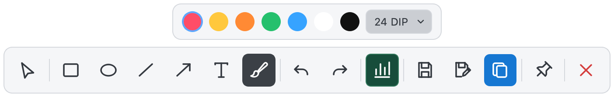
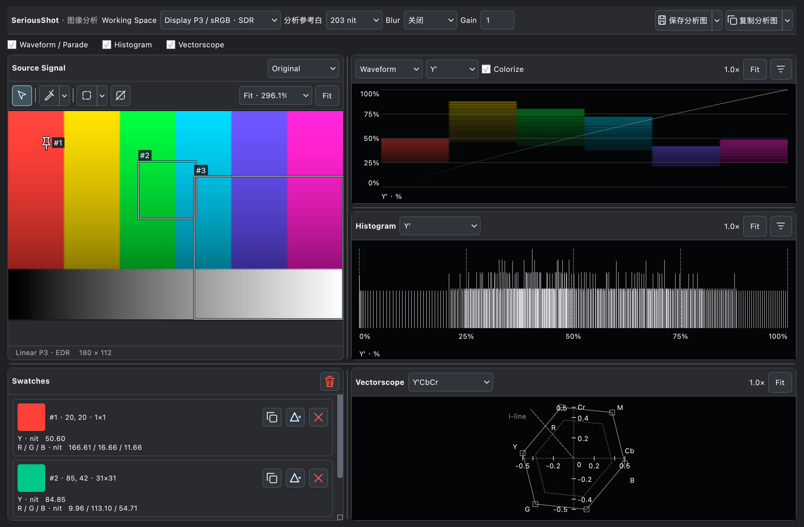
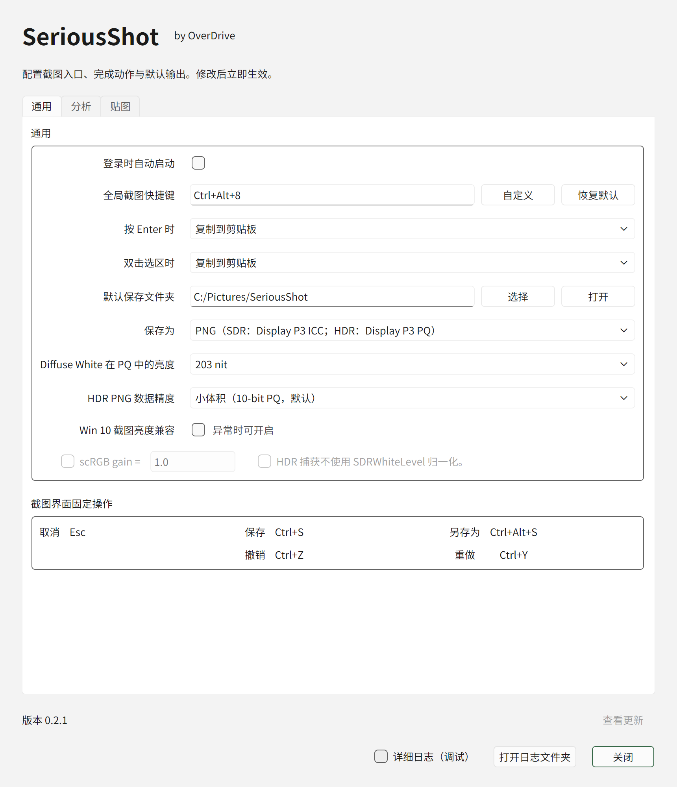
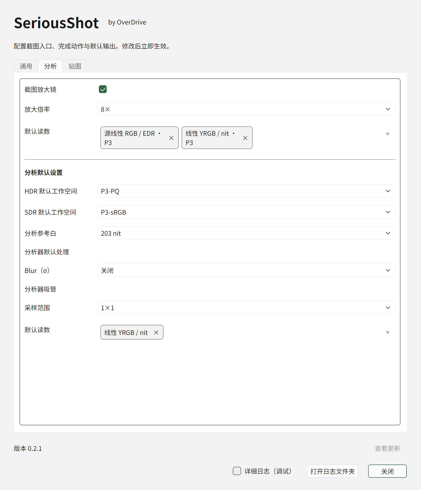
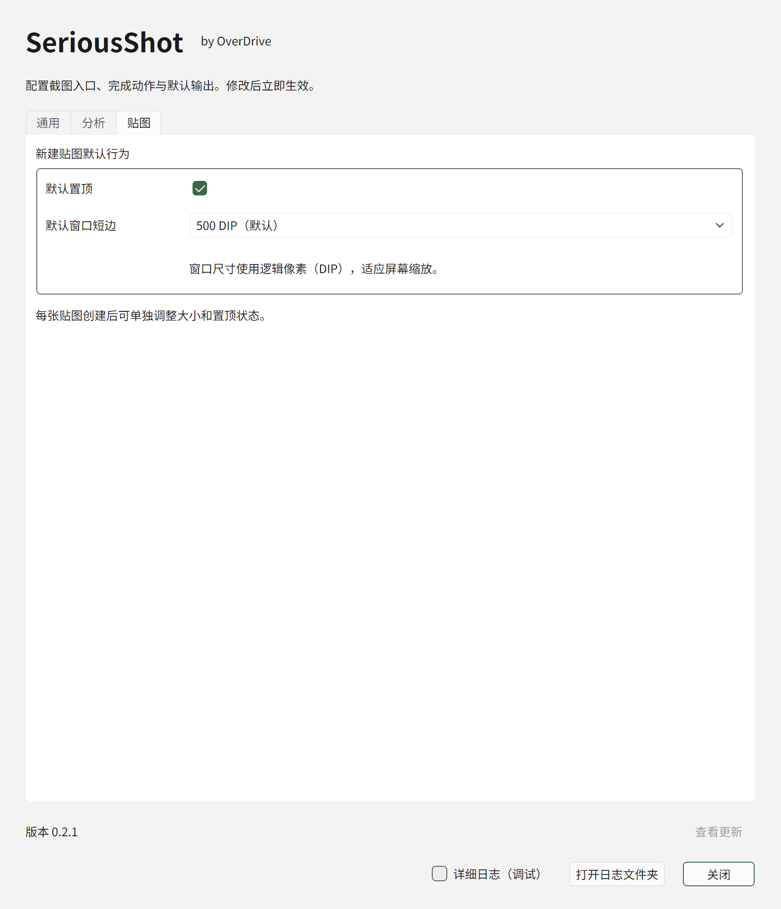

# SeriousShot

最后更新：2026-11-05 01:18:02 CST

[简体中文](README.md) · English

**Capture HDR and wide-gamut screens, annotate the selection, and preserve the color. Open the Analyzer when you need a closer look.**

SeriousShot is a screenshot tool for macOS and Windows. It focuses on HDR capture, SDR color management, and predictable color when you share the image.

- **Annotate in the selection.** Add rectangles, ellipses, lines, arrows, text, or freehand strokes in seven colors. Move and resize annotations, change their color or thickness, and undo or redo edits.
- **Color management for HDR and SDR.** Exports preserve HDR information and the corresponding color metadata.
- **Two export formats.** Use PNG to preserve detail. Ultra HDR JPEG uses an ISO 21496-1 gain map for HDR playback and opens in ordinary JPEG viewers.
- **Analyze a capture immediately.** Inspect the Waveform, Histogram, Vectorscope, or individual readings. Use an eyedropper, an analysis mask, or False Color.

## Capture and format choices

macOS 26 can save [HDR screenshots as HEIF](https://support.apple.com/en-au/102646) on supported Macs. SeriousShot offers PNG and Ultra HDR JPEG for workflows that already use those formats. On Windows it also offers those formats for HDR workflows that use JXR (JPEG XR).

For SDR, SeriousShot converts pixels to standard Display P3 and embeds the matching matrix-shaper ICC profile. A color-managed viewer can interpret the pixels using the embedded profile.

HDR rendering depends on your display, system, and viewer. HDR PNG requires PQ support. Ultra HDR JPEG requires a gain-map-aware viewer for HDR playback, and ordinary JPEG viewers can display the SDR base image.

[Version 0.2.2](https://github.com/OverDriveHuang/SeriousShot/releases/tag/v0.2.2) is available as a Windows x64 ZIP and a macOS arm64 DMG.

## Capture, annotate, and share

Start a capture and select an area. Add rectangles, ellipses, lines, arrows, text, or freehand strokes in the selection. Move, resize, recolor, or change the thickness of annotations. Then copy the result, save it, choose Save As, or open the Analyzer.



## Pin a screenshot and recover from a capture failure

Pin multiple screenshots to the desktop. Pan or zoom each pinned window, fit the image to the window, or view it at 1:1. You can save, copy, or open it in the Analyzer. Collapse a window to a thumbnail and hover to preview it before expanding.

If no new valid screen frame arrives for two seconds, SeriousShot reports a capture timeout. Retry with the capture shortcut or menu. When the system is still finishing the previous capture, the app asks you to wait. Detailed logs show the capture stage and the underlying error.

## SDR and HDR output

### PNG

- **SDR.** Display P3 pixels with an embedded ICC profile for color-managed viewers.
- **HDR.** Display P3 with PQ and embedded color and luminance metadata. Choose 10-, 12-, or 16-bit precision.

### Ultra HDR JPEG

For HDR content, the JPEG contains an SDR base image and a gain map with ISO 21496-1 and XMP metadata. Ordinary viewers display the SDR image. Gain-map-aware viewers can reconstruct HDR. SDR captures are saved as ordinary JPEGs with an embedded ICC profile.

## Analyzer



- **Waveform and Parade.** Inspect luminance and channel distributions across the image. Add reference lines to check highlights and shadows.
- **Histogram.** View luminance, RGB, and hue distributions, including an Adobe Style view with separate SDR and HDR ranges.
- **Vectorscope.** View the distribution and working-gamut boundary in Y′CbCr, Lab, or ITP.
- **Eyedropper and Swatches.** Sample a pixel or average an area. Keep swatches and locate their mean values and area distributions in the scopes.
- **Mask and False Color.** Limit the analysis area or inspect luminance with False Color. Changing the False Color view leaves the data used by the other scopes intact.

The Analyzer offers four working spaces based on Display P3, sRGB, and BT.2020, 100 or 203 nit reference white, Blur, and display Gain. Drag the splitters to arrange panels. Zoom and pan the scopes. You can save or copy the current Analyzer view as an image, including in HDR.

## Settings

The General, Analysis, and Pinned tabs are available on both platforms. The screenshots below show the Windows 0.2.1 layout in Chinese.



Set the capture shortcut, actions for Enter and double-click, output folder, and PNG or JPEG format. PNG offers HDR precision and reference white settings. JPEG has its own quality setting. Windows also offers capture brightness compatibility for Windows 10. These settings take effect immediately.

The interface supports Simplified Chinese and English. Until you choose a language, SeriousShot follows the system display language: Chinese uses Simplified Chinese, and all other languages use English. Choose **中** or **EN** at the top right of Settings to save your preference. Click the restart message beside the buttons and confirm to restart the app and apply the language.

Launch at login is off by default. When enabled, SeriousShot starts in the Windows notification area or macOS menu bar, with the capture shortcut ready. Opening the app manually shows Settings. Quitting preserves the next-login preference. If Windows has disabled the startup entry, turn SeriousShot on in Windows **Settings → Apps → Startup**. The checkbox refreshes when you return to the app.



In **Analysis**, set the capture magnifier, default readings, HDR and SDR working spaces, and reference white. The default processing section controls Blur. The eyedropper section controls the sample area and readings.



In **Pinned**, set whether new windows stay on top and their initial short edge. Choose 450 to 800 DIP, with 500 DIP as the default. DIP are logical pixels that follow display scaling. You can still adjust each window after opening it.

## Getting started

### Windows

Download the [Windows x64 ZIP for 0.2.2](https://github.com/OverDriveHuang/SeriousShot/releases/tag/v0.2.2). Extract the entire ZIP to a writable folder before running SeriousShot.

### macOS

Download the [macOS arm64 DMG for 0.2.2](https://github.com/OverDriveHuang/SeriousShot/releases/tag/v0.2.2).

1. Open the DMG and drag **SeriousShot.app** into **Applications**.
2. Launch SeriousShot from Applications and set the capture shortcut and output format.
3. Press the capture shortcut. When prompted, allow SeriousShot in **System Settings → Privacy & Security → Screen & System Audio Recording**. Some macOS versions call this **Screen Recording**. Follow any system prompt to quit and reopen the app.
4. Press the shortcut again, select an area, and add any annotations. Copy or save the result, or open the Analyzer.

SeriousShot 0.1.5 and later can check for updates and download and verify the installer. Open the downloaded DMG, quit SeriousShot, then drag the new app into Applications and choose **Replace**. To upgrade from 0.1.4 or earlier, download the current installer manually. If you installed an old copy elsewhere, remove it before launching the replacement.

The macOS 0.2.2 app and DMG are Apple Developer ID signed and notarized. If screen capture stops working after replacing the app and macOS still lists SeriousShot as allowed, renew the permission:

1. Start the replacement app and press the capture shortcut to trigger the permission prompt.
2. In the system screen recording settings, select SeriousShot and click **−** below the list to remove the old entry.
3. Return to the app and press the shortcut to request permission again.
4. Turn the SeriousShot permission on in System Settings.
5. When prompted, quit and reopen SeriousShot, then retry the capture.

### Command-line capture

On Windows, run these commands from the extracted app folder.

```powershell
.\SeriousShot.exe --help
.\SeriousShot.exe --list-displays
.\SeriousShot.exe --capture
$id = Read-Host 'Enter a display ID from --list-displays'
.\SeriousShot.exe --capture --display $id 100 80 900 680
```

On macOS, run the executable inside the app bundle.

```sh
/Applications/SeriousShot.app/Contents/MacOS/SeriousShot --help
/Applications/SeriousShot.app/Contents/MacOS/SeriousShot --list-displays
/Applications/SeriousShot.app/Contents/MacOS/SeriousShot --capture
```

`--list-displays` prints display IDs, the primary display flag, and desktop coordinates and dimensions in logical points. `--capture` defaults to the primary display. Use `--display ID` to select another display and optionally append `x1 y1 x2 y2` for a rectangle. Coordinates increase to the right and down. A display to the left of or above the primary display can have negative coordinates. The rectangle is clipped to the target display.

The output uses the captured physical resolution and the app's saved export settings. A successful capture prints the full file path to standard output and exits with code 0. Invalid usage exits with code 2. Capture failure exits with code 1.

## System support

| System | Minimum | Scope |
| --- | --- | --- |
| macOS | **15.5** | Capture, annotations, and Analyzer. See tested displays below. |
| Windows | **Windows 11**, with limited compatibility for **Windows 10 21H2** | Capture, annotations, Analyzer, and export. See tested configurations below. |

The maintainer observed the following capture results on specific devices.

| System and display | Test conditions | Observed result |
| --- | --- | --- |
| Windows 10 21H2 | scRGB gain **0.5** and SDRWhiteLevel normalization disabled for HDR capture. Tested in HDR and Legacy wide-gamut modes. | No issues observed in those modes |
| Windows 11 26H2 | ACM, Legacy, and HDR modes | No issues observed in those modes |
| Windows 11 25H2 | ACM, Legacy, and HDR modes in an earlier trial | No issues observed in those modes |
| macOS 15.5, built-in non-XDR display | Maximum EDR about **2** | No issues observed |
| macOS 15.5, one external third-party HDR display | External HDR capture | **Known issue. Captures were overexposed.** |
| macOS 26 and 27, built-in and external XDR displays | **Reference Mode** | No issues observed in the tested combinations |
| Other OS versions, display combinations, and modes | Untested | Unconfirmed |

HDR previews require a compatible display and system configuration. On Windows, color handling differs across Legacy SDR, Auto Color Management (ACM), and HDR. Legacy SDR uses the display's ICC profile for pixel conversion. Unrecognized display modes use the Legacy path. Systems without borderless capture use the bordered capture API.

Some Windows 10 systems can produce captures that are too bright, dark, or washed out. On affected Windows 10 21H2 systems, capture values were approximately twice the expected linear values. The Windows 10 capture brightness compatibility setting is off by default. Enabling both options sets scRGB gain to **0.5** and bypasses SDRWhiteLevel normalization for HDR capture. The tested Windows 11 systems did not need this setting.

## Development and feedback

See the [build instructions](docs/BUILDING.md) to build from source. When reporting a problem, include the OS version, whether the display is built in or external, the HDR setting, and steps to reproduce. Remove private information from screenshots before sharing them.

## License

SeriousShot is available under the [MIT License](LICENSE). Copyright (c) 2026 OverDrive. Modification, distribution, and commercial use are permitted under the license, with the copyright and license notices retained.

Third-party components have their own licenses. See [THIRD_PARTY_NOTICES.md](THIRD_PARTY_NOTICES.md).
